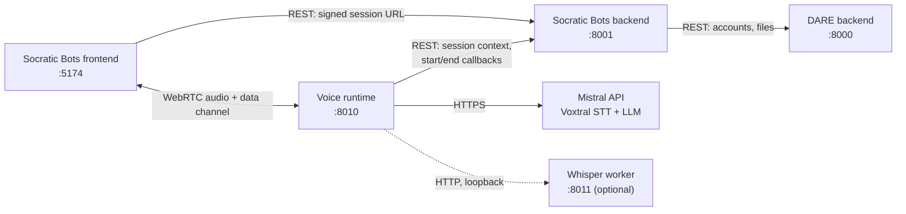

# Voice Agent Runtime

> Real-time voice runtime for **Socratic Bots** voice agents, built on Pipecat, FastAPI and WebRTC.

[](LICENSE)
[](https://www.python.org/)

## What is Socratic Bots?

Socratic Bots lets educators build AI tutors that teach by asking questions
instead of handing out answers. Instructors set up bots with their own course material, prompts and
access rules. Students chat with them in the browser, or talk to them out loud in voice sessions such
as oral exams.

Socratic Bots runs on top of [DARE](https://github.com/cmudco/dare-backend), the Dietrich Analysis
Research Education platform. Accounts, LLM chat, file processing, retrieval and billing all live in
DARE. Socratic Bots adds the teaching layer: bots, bot groups, access codes, notes and voice agents.

> **Requires the Socratic Bots backend, which requires DARE.** This runtime is not a standalone
> product. It serves voice sessions that the
> [Socratic Bots backend](https://github.com/cmudco/socraticbots-backend) creates and signs, and the
> backend in turn needs a running [DARE backend](https://github.com/cmudco/dare-backend). DARE runs
> without Socratic Bots; the reverse is not true.

**This repository is the voice runtime.** It owns the live audio of a voice session and stores
nothing: agents, sessions and transcripts live in the Socratic Bots backend. It handles:

- The WebRTC connection to the student's browser
- Listening and turn detection, speech-to-text, the LLM reply and text-to-speech
- Recovery when speech-to-text or the LLM fails mid-session
- Reporting the transcript and session health metrics to the backend when the session ends

## Overview



The Socratic Bots backend decides who may start a session and gives the browser a short-lived signed
token, which the browser presents when it opens the WebRTC connection. The runtime then fetches the
session configuration (prompt, voice, language, model) from the backend, runs the conversation, and
posts the transcript and session health metrics back. [ElevenLabs](https://elevenlabs.io/) voice
agents are a separate provider that the backend and frontend handle directly, without this runtime.

## Features

- **WebRTC transport.** Microphone audio, agent audio and control events travel over Pipecat's
  `SmallWebRTCTransport`.
- **Server-side turn detection.** Silero VAD, tunable through environment variables.
- **Streaming speech-to-text.** Mistral Voxtral realtime.
- **STT recovery.** A liveness watchdog rebuilds a stalled STT connection and replays the buffered
  turn. An optional self-hosted [Whisper](docs/how-to/whisper-backup.md) worker takes over if
  Mistral keeps failing.
- **LLM fallback chain.** The agent's model is tried first; on an error or a slow first token the
  next model in `VOICE_RUNTIME_LLM_FALLBACKS` answers the turn. Mistral, OpenAI, Anthropic and
  Gemini work through their OpenAI-compatible endpoints.
- **Text-to-speech.** Local Kokoro (ONNX, no API key) streamed on the WebRTC track, or Mistral
  Voxtral TTS played as buffered WAVs over HTTP.
- **Barge-in and interruption recovery.** Students can interrupt the agent; an interruption that
  produced no words resumes the agent's reply once.
- **STT Lab mode.** A microphone-to-transcript pipeline with no LLM or TTS, for testing recognition.
- **Session health metrics.** Latency, retries, fallbacks and exit reason go back to the backend; no
  audio is stored.

## Quick start

You need Python 3.12, a Mistral API key, and a running Socratic Bots backend.

```bash
git clone https://github.com/cmudco/voice-agent-runtime.git
cd voice-agent-runtime
python3.12 -m venv .venv && source .venv/bin/activate
pip install -r requirements.txt
pip install --no-deps -r requirements-pipecat.txt
cp .env.example .env    # set MISTRAL_API_KEY and DARE_INTERNAL_KEY
uvicorn runtime.pipecat_app:app --host 0.0.0.0 --port 8010
curl http://localhost:8010/health
```

The runtime is now on <http://localhost:8010>. Set `VOICE_RUNTIME_PUBLIC_URL=http://localhost:8010` in
the Socratic Bots backend so it can send sessions here. The full walkthrough, including why the
install is two steps, is in [docs/tutorials/quickstart.md](docs/tutorials/quickstart.md).

## Documentation

| Kind | Doc | What's in it |
| --- | --- | --- |
| Tutorial | [docs/tutorials/quickstart.md](docs/tutorials/quickstart.md) | Run the runtime locally and connect it to the Socratic Bots backend |
| How-to | [docs/how-to/deploy.md](docs/how-to/deploy.md) | Production: systemd, reverse proxy, TURN, Whisper backup, deploy gate |
| How-to | [docs/how-to/whisper-backup.md](docs/how-to/whisper-backup.md) | Setting up the self-hosted Whisper STT backup |
| How-to | [docs/how-to/testing.md](docs/how-to/testing.md) | Automated tests and the manual voice acceptance checklist |
| Reference | [docs/reference/configuration.md](docs/reference/configuration.md) | Every environment variable the runtime and Whisper worker read |
| Explanation | [docs/explanation/architecture.md](docs/explanation/architecture.md) | Pipeline stages, session lifecycle, tokens, backend callbacks |
| Explanation | [docs/explanation/http-wav-architecture.md](docs/explanation/http-wav-architecture.md) | Historical design note from the HTTP-WAV era |
| Project | [.github/CONTRIBUTING.md](.github/CONTRIBUTING.md) | Issues, pull requests, checks, conventions, AI coding agents |
| Project | [.github/SECURITY.md](.github/SECURITY.md) | Reporting vulnerabilities and hardening notes |
| Project | [AGENTS.md](AGENTS.md) | Commands and traps for AI coding agents |

## Tech stack

- **Python 3.12**, **FastAPI**, **Uvicorn**
- **Pipecat** 1.2 (`SmallWebRTCTransport`, aiortc)
- **Silero VAD** (local)
- **Mistral** Voxtral realtime STT, Voxtral TTS and LLMs (`mistralai`, `openai` client against
  Mistral's OpenAI-compatible API)
- **Kokoro** TTS via `kokoro-onnx` and ONNX Runtime (local)
- **faster-whisper** for the optional STT backup worker
- **Sentry** for error reporting (optional)

## What is included in this repo?

- `runtime/` — the FastAPI app, Pipecat pipelines, STT/LLM resilience, Whisper worker
- `tests/` — unit tests and a Whisper smoke test
- `scripts/` — Whisper backup setup and a metadata-only local log capture wrapper
- `requirements*.txt`, `.env.example`, `Dockerfile`
- `deploy.sh` and `.github/workflows/deploy-staging.yml` — the maintainers' own deploy scripts,
  provided as a reference

## What is not included in this repo?

- [socraticbots-backend](https://github.com/cmudco/socraticbots-backend) — creates voice sessions,
  signs tokens, stores agents and transcripts (required)
- [socraticbots-frontend](https://github.com/cmudco/socraticbots-frontend) — the web app students and
  instructors use
- [dare-backend](https://github.com/cmudco/dare-backend) — accounts, LLM access and files for the
  whole platform (required by the Socratic Bots backend)
- Model weights. Kokoro and Whisper models are downloaded on first use.

## Stay in touch

- **Found a bug or have a feature request?** Open an issue on this repository.
- **Found a security issue?** Follow [.github/SECURITY.md](.github/SECURITY.md); do not open a public issue.
- **Questions or general inquiries?** Email the project team at vks@andrew.cmu.edu.

## Acknowledgements

Socratic Bots is developed at the Dietrich College of Humanities and Social Sciences, Carnegie Mellon
University, and is built on the [DARE](https://github.com/cmudco/dare-backend) platform. The runtime
is built on [Pipecat](https://github.com/pipecat-ai/pipecat).

"DARE" (Dietrich Analysis Research Education Platform) and "SocraticBots" are trademarks of Carnegie
Mellon University. Trademark and licensing questions go to vks@andrew.cmu.edu.

The runtime calls third-party APIs (Mistral, and optionally OpenAI, Anthropic and Google Gemini).
Each provider's own terms of service apply.

## Contributors

Socratic Bots is built and maintained by the team at the Dietrich College of Humanities and Social
Sciences, Carnegie Mellon University.

**Creators**

<table>
  <tr>
    <td align="center" valign="top" width="33.33%"><br /><sub><b>Sayeed Choudhury</b></sub><br />Creator</td>
    <td align="center" valign="top" width="33.33%"><br /><sub><b>Vincent Sha</b></sub><br />Creator</td>
    <td align="center" valign="top" width="33.33%"><br /><sub><b>George Cann</b></sub><br />Creator</td>
  </tr>
</table>

**Team**

<table>
  <tr>
    <td align="center" valign="top" width="33.33%"><br /><sub><b>Carl Skipper</b></sub><br />Contributor</td>
    <td align="center" valign="top" width="33.33%"><br /><sub><b>Muhammad Abdurrehman</b></sub><br />Team Lead</td>
    <td align="center" valign="top" width="33.33%"><br /><sub><b>Brian Wingenroth</b></sub><br />Developer</td>
  </tr>
  <tr>
    <td align="center" valign="top" width="33.33%"><br /><sub><b>Farhat Abbas</b></sub><br />Developer</td>
    <td align="center" valign="top" width="33.33%"><br /><sub><b>Hariss M.</b></sub><br />Developer</td>
    <td align="center" valign="top" width="33.33%"><br /><sub><b>Eira Khan</b></sub><br />QA</td>
  </tr>
</table>

## License

This project is licensed under the [GNU Affero General Public License v3.0](LICENSE) (AGPL-3.0-only),
© 2024–2026 Carnegie Mellon University, Dietrich College of Humanities and Social Sciences. The full
text is in [LICENSE](LICENSE) and at <https://www.gnu.org/licenses/agpl-3.0.en.html>.
